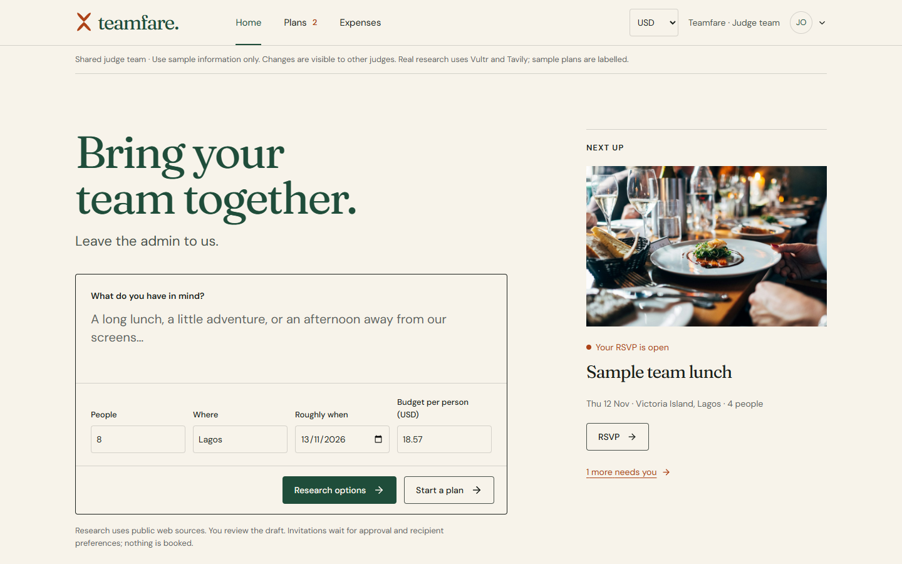
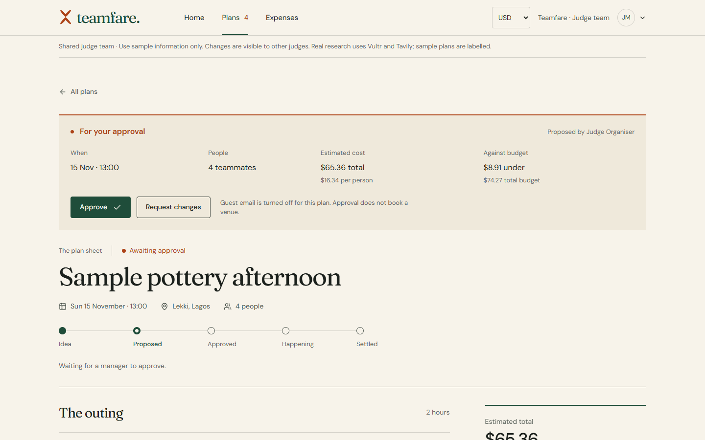
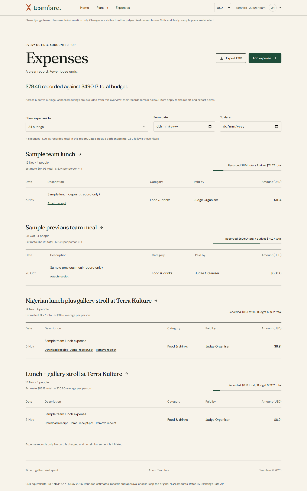
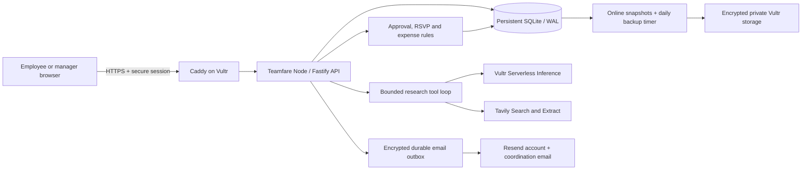

<p align="center">
  
</p>

<h1 align="center">Teamfare</h1>

<p align="center">
  
  
  
  
  
</p>
<p align="center">
  
  
  
  
</p>
<p align="center">
  
  
  
  
  
</p>

<p align="center"><strong>Bring your team together. Leave the admin to us.</strong></p>

<p align="center">
  A team outing, from a rough idea to a reviewed plan and a clear expense record.<br />
  Research real options, keep a human in charge, and carry the evidence into the decision.
</p>

<p align="center">
  <a href="https://teamfare.dixmail.xyz">Live app</a> ·
  <a href="#how-teamfare-works">How it works</a> ·
  <a href="#architecture">Architecture</a> ·
  <a href="#getting-started">Getting started</a> ·
  <a href="docs/DEPLOYMENT.md">Deployment</a> ·
  <a href="#license">License</a>
</p>

## Judge access — no signup needed

Open **[Teamfare](https://teamfare.dixmail.xyz)** and sign in with either public account:

| Account | Email | Password |
| --- | --- | --- |
| Organiser / employee | `organiser@judges.teamfare.invalid` | `TeamfareOrganiser2026!` |
| Manager | `manager@judges.teamfare.invalid` | `TeamfareManager2026!` |

Both accounts belong to the same **Teamfare · Judge team**. Use a normal window and a private window, or separate browser profiles, to try both roles together. These two seeded accounts require **no signup or email code**. The `.invalid` addresses are deliberate demo identifiers, not real inboxes. Ordinary accounts still require email ownership verification and a code at sign-in.

The team includes labelled sample outings, a proposal awaiting approval, and expense records. Start a fresh plan as the organiser to try the complete workflow; the manager cannot approve a plan they organised themselves. Shared records are visible to other judges, so use sample information. Shared passwords cannot be changed, invitations are disabled, and each judge account shares its four-research-runs-per-hour allowance with other visitors. The local sample-team preview remains available without using provider credits.

For local setup, run `npm run seed:judges` once after configuring the application. Operators can run that same command inside the deployed app container. Rerunning it preserves existing judge credentials and activity and refuses conflicting account identities. Judge provisioning never marks a real account as a demo account.

---

## Contents

- [Overview](#overview)
- [How Teamfare works](#how-teamfare-works)
- [Product screenshots](#product-screenshots)
- [Architecture](#architecture)
- [Technology stack](#technology-stack)
- [Getting started](#getting-started)
- [Configuration](#configuration)
- [Agent evidence and boundaries](#agent-evidence-and-boundaries)
- [Accounts and team permissions](#accounts-and-team-permissions)
- [Expenses and reporting](#expenses-and-reporting)
- [Development and validation](#development-and-validation)
- [Deployment](#deployment)
- [Repository structure](#repository-structure)
- [Documentation](#documentation)
- [Current scope and remaining work](#current-scope-and-remaining-work)
- [Contributing](#contributing)
- [License](#license)
- [Third-party notices](#third-party-notices)

## Overview

Teamfare helps employees and managers bring teams together through shared meals, outings and activities. An organiser describes an idea; a bounded planning agent searches public pages, reads evidence and compares practical options. The organiser turns one option into an editable **Plan Sheet**, requests a manager's review, collects RSVPs and records expenses afterwards.

Built for **Vultr Agent Rush — Powering the Future of Work**. The web app, central Node API, workflow orchestration and persistent SQLite data run on Vultr Cloud Compute. Vultr Serverless Inference powers tool calling, Tavily supplies search/extraction, and Resend delivers account verification and recovery messages. The model does not hold the authority to approve spending or make a booking.

| Capability | What works |
| --- | --- |
| Research | Searches and reads real public sources, compares two or three options, retains citations and confirmation questions. |
| Plan Sheet | Edits the outing, guest list, itinerary and cost assumptions in one document. |
| Cost ledger | Calculates per-person and fixed costs, total estimate, allowance and remaining budget deterministically. |
| Display currency | USD by default, with a saved NGN option; converted forms, plans and reports use a dated reference rate. |
| Manager review | Requires another manager, supports changes with a pinned note, and rejects stale or over-budget approvals. |
| Coordination | Collects availability replies, ranks proposed times, saves interests, emails opted-in guests and supports RSVP and calendar export. |
| Expenses | Records actual team entries, attaches private PDF/PNG/JPEG receipts and retains an activity history. |
| Reporting | Filters by outing and inclusive expense dates, exports formula-safe CSV and lets managers email the selected report to a verified teammate. |
| Accounts | Verified signup, password-plus-email-code login, recovery, password changes and session revocation. |
| Judge access | Separate public organiser/manager accounts with labelled sample data and restricted account administration. |

## How Teamfare works

1. **Describe the outing.** Enter the brief, headcount, location, date and per-person allowance on Home. Use **Research options**, or **Start a plan** for manual planning.
2. **Compare evidence.** The agent calls search and page-reading tools, returns choices with source links, separates estimates from quoted prices, and lists what still needs confirming.
3. **Shape the plan.** Choose **Use this plan**, refine the itinerary and cost assumptions, and select actual teammates. Fixed costs and per-person lines recalculate as headcount changes.
4. **Ask for review.** Send the proposal to a different manager. The manager approves it or requests changes with a required note. Approval is a team decision, not a venue booking.
5. **Coordinate attendance.** Before review, propose times and collect named guests' explicit availability. Choose a time, acknowledging unanswered replies or conflicts when necessary. After approval, opted-in guests receive invitations and scheduled reminders; they RSVP in the Plan Sheet or download its calendar event. Email status distinguishes provider acceptance from inbox delivery.
6. **Finish the expense record.** Record costs and private receipts against the approved outing. Filter the report by outing/date, then export CSV or explicitly email it to a verified teammate as a manager. A manager can settle a past outing to close expense recording.

### Quick judge walkthrough

- Sign in as the **organiser** and open **Sample team lunch** to RSVP or record a sample expense.
- Sign in as the **manager** in another browser profile. Review **Sample pottery afternoon**, request changes with a note, then return to the organiser to revise and resubmit it.
- To demonstrate live AI research, start a fresh research run as the organiser and follow the complete journey above. Existing seeded plans are authored samples, not claimed agent results.
- Open **Expenses**, set **From date** and **To date**, inspect the report total and download CSV.

## Product screenshots

Screenshots use the isolated public judge team and labelled sample records. The catalogue photography illustrates experiences; it does not verify a specific Lagos venue.







## Architecture



The API owns identity, team membership, validation, revisions, deterministic cost calculations and state transitions. The model receives the outing brief and planning fields, not account passwords, session tokens or the team's expense history. Public sources reach the agent through fixed provider APIs; the model cannot fetch arbitrary account resources or execute generated code.

The production app runs as a nonroot container with a read-only filesystem and a private persistent data volume. The API port binds only to host loopback. Caddy provides HTTPS, and provider keys remain server-side. See [backend operations](docs/BACKEND.md), [agent review](docs/AGENT-REVIEW.md) and [deployment](docs/DEPLOYMENT.md).

## Technology stack

| Area | Technology |
| --- | --- |
| Application | React 19, TypeScript 7, Vite 8 |
| Interface | Custom CSS, original SVG mark, locally bundled Fraunces and DM Sans, Lucide icons |
| Backend | Node.js 24 LTS, Fastify 5, Zod validation |
| Persistence | Node SQLite, WAL, foreign keys, transactions and versioned migrations |
| Agent | Vultr Serverless Inference tool calling; Tavily Search and Extract |
| Account delivery | Resend, verified sender domain, durable password-security notifications |
| Hosting | Vultr Ubuntu VM, Docker Compose, Caddy HTTPS |
| Validation | TypeScript, Node test runner, Playwright, Oxlint |

## Getting started

### Requirements

- A patched **Node.js 24 LTS** release, version 24.19 or later within Node 24.
- npm and Git.
- Chromium or installed Chrome for browser checks.
- Provider credentials for real research and email-backed accounts; the local sample preview needs none.

### Install and run

```sh
git clone https://github.com/ELLA0VICTOR/teamfare.git
cd teamfare
npm ci
```

Copy `.env.example` to `.env`, preserving any existing local settings, then configure the values below.

```sh
npm run dev
```

Vite defaults to **http://localhost:5173** and proxies `/api` to `127.0.0.1:3001`. Use the exact browser origin configured in `APP_ORIGIN`; an occupied port fails instead of silently selecting a different origin. On Windows, use `npm.cmd` if PowerShell blocks `npm.ps1`.

For the two public judge roles locally:

```sh
npm run seed:judges
```

**Explore the sample team** opens a separate browser-local preview with a role switch and reset control. Its `teamfare-preview-v1` localStorage data is never uploaded into a real team. Signed-in records live in SQLite, not localStorage.

For a private team, choose **Create a team**, verify your email, then generate a one-use invitation for a teammate. Invitations expire after three days; share the code or email it to a specific address. Addressed invitations can only be redeemed by that verified email. Use a different browser profile to join with the invited role. Outing emails require each recipient's explicit opt-in; existing accounts start with them off.

## Configuration

| Setting | Purpose |
| --- | --- |
| `HOST`, `PORT` | API bind address and port; local default `127.0.0.1:3001`. |
| `APP_ORIGIN` | Exact browser origin. Production requires HTTPS. |
| `DATABASE_PATH` | Persistent SQLite file; local default `./data/teamfare.sqlite`. |
| `TZ` | Local service timezone; workflow dates use Africa/Lagos. |
| `VULTR_INFERENCE_API_KEY` | Serverless Inference key, separate from the management API key. |
| `VULTR_INFERENCE_MODEL` | Tool-calling model supporting the adapter's reasoning controls. |
| `TAVILY_API_KEY` | Server-side search and extraction. |
| `RESEND_API_KEY`, `EMAIL_FROM` | Account email delivery using a verified sender domain. |
| `AUTH_SECRET` | Stable random server secret, at least 32 characters. |
| `TRUST_PROXY` | `1` only behind one controlled proxy with the API port private. |
| `VULTR_API_KEY` | Optional operator-only provisioning key; excluded from the app container. |
| `TEAMFARE_DOMAIN` | Public deployment hostname for Caddy. |

Keep real values in `.env` or the private runtime environment. Never use `VITE_` variables for secrets. See [provider setup and credits](docs/PROVIDER-SETUP.md) and [email/authentication setup](docs/AUTHENTICATION.md). Missing providers produce explicit failures; they do not substitute sample research.

## Agent evidence and boundaries

The tool loop exposes only **web_search**, **read_sources** and **submit_options**. Source reading accepts IDs previously returned by search. The server validates venue names against read evidence and requires an exact read-page NGN quote for a published-price claim. Edited or uncertain costs are estimates. Source text is untrusted input, not new instructions.

Runs have a three-minute deadline, twelve model turns, four searches and three extraction calls of up to four pages each. The final three turns are reserved for submission/correction. Completions have an 8,192-token limit with a 1,024-token reasoning budget at low effort; truncated output is rejected. Each user can start four runs per hour, with one active per user and two per process. Persistent UTC daily limits allow ten starts per team and twenty across the deployment. Cancellation, provider errors, quotas and interrupted runs remain visible. These limits are not a guaranteed monetary spending cap.

Choosing a result creates at most one sourced draft per research run. Cost totals come from code. Venue availability, final charges, dietary requirements and booking terms still need direct confirmation. The agent cannot approve spending, book, pay, send invitations or execute shell commands.

## Accounts and team permissions

Normal accounts require matching passwords of 15–128 characters and proof of email ownership before activation. Fresh sign-in requires a password and a single-use emailed code. Passwords use salted scrypt; session and invitation tokens are stored as hashes. Production cookies are Secure, HttpOnly, host-only and SameSite=Lax. Origin and CSRF checks protect authenticated writes.

Roles and teams are resolved on the server. An organiser edits their draft; another manager reviews it; only named attendees RSVP. Stale writes return a conflict instead of silently overwriting newer state. Recovery and password changes revoke existing sessions and pending proofs. Open **Account security** to change a normal account's password or sign out everywhere.

Public judge access is an explicit exception for two operator-seeded accounts in a separate team. Signup cannot grant that status. Judge passwords, global session revocation and member invitations are locked; normal per-session sign-out remains available. Do not put private information in the shared judge team.

## Expenses and reporting

USD is the default display currency. The header selector also offers NGN and remembers the choice in this browser. This is an explicit display preference, not an automatic assumption based on a person's location. USD inputs convert through the displayed rate; merely switching currency never rewrites records or changes approval limits. Source quotes remain in their original currency. Rates refresh daily when available, retain a dated cached reference during an outage, and are attributed to [ExchangeRate-API](https://www.exchangerate-api.com/docs/free).

Expense rows retain the outing, description, category, payer, whole-NGN source amount and date. Employees record their own expenses on eligible outings; managers can choose another teammate. Recording is a database transaction and appends a real activity event. No payment or reimbursement is initiated.

The team overview shows recorded spending against active-outing budgets. The report beneath it filters by outing and inclusive **From date / To date**, with its own record count and total. Invalid ranges are announced and cannot be exported. CSV uses the same filtered rows and escapes spreadsheet formula prefixes. NGN exports retain the original six columns; USD exports include dollar amounts, original amounts and the exact rate, date and source. Emailed reports use the same selected currency and stored rate snapshot. Cancelled outing records remain inspectable. Settling a past outing closes further expense recording.

Receipts accept PDF, PNG or JPEG up to 5 MB, with file-signature validation, 100 MB per team and 512 MB for the deployment. Only the expense creator, payer or a manager can access them. Files are downloaded as attachments and stored inside private SQLite backups. Settled/cancelled outings retain downloads but reject attachment changes. No OCR or malware-scanning claim is made.

Manager-requested email reports use the same filters, CSV columns and formula escaping as downloads. The recipient must be a verified teammate. Reports are limited to 2,000 records, 1 MB and ten requests per team per day. See [coordination and expense workflows](docs/WORKFLOWS.md) for scheduling, consent, retry and privacy rules.

## Development and validation

```sh
npm run build
npm run lint
npm run test:api
npx playwright install chromium
npm run test:browser
npm run test:live
npm run test:agent
```

Build before API tests because production-serving checks use the compiled frontend. On Windows with installed Chrome:

```powershell
$env:TEAMFARE_BROWSER_CHANNEL = 'chrome'
npm.cmd run test:browser
npm.cmd run test:live
npm.cmd run test:agent
```

| Command | Coverage |
| --- | --- |
| `npm run test:api` | Identity, permissions, revisions, judge isolation, seed idempotence, research evidence/cost limits, provider protocols and backup restoration. |
| `npm run test:browser` | Local-preview journeys, mobile navigation, legacy persistence, review notes, costs, expenses, CSV and settlement. |
| `npm run test:live` | Isolated account/OTP/recovery journeys, two-user workflows, public judge roles and date-range CSV reporting. |
| `npm run test:agent` | Labelled provider fixtures for evidence, option selection, edited drafts, persistence and manager review. |
| `npm run agent:models` | Read the public Vultr model catalogue without a paid inference call. |
| `npm run format` | Format application, server and browser checks. |

Automated account/research browser suites use separate ignored databases and test-only mail/provider fixtures. They do not write to the normal `data/` database or prove live provider access. Separate real-email and real-provider deployment checks are recorded in [the deployment runbook](docs/DEPLOYMENT.md). Validation establishes the exercised behaviour, not an absence of all bugs.

## Deployment

The live app and central backend run on one **Vultr Ubuntu 24.04 VM in London**, with persistent SQLite and Caddy HTTPS. The selected 1-vCPU/2-GB plan was quoted at $10/month before credits; inference, search and email usage are separate services.

```sh
node deploy/vultr.mjs inspect
node deploy/prepare.mjs
```

`inspect` is read-only. `prepare` creates a source-only archive and a separate private runtime environment. Follow [the deployment runbook](docs/DEPLOYMENT.md) for provisioning, source-IP-restricted SSH, initial data import, DNS, activation, rollback and judge seeding. Never rerun the initial-data import to update an existing deployment.

The daily timer creates SQLite-consistent online snapshots, validates integrity and retains seven days locally. Production encrypts snapshots with AES-256-GCM before uploading to private Vultr Object Storage in Amsterdam, then downloads and restores each upload for verification. Storage lifecycle rules archive copies after seven days and expire them after thirty. The recovery key is separate from application credentials and retained privately off the VM. Independent GitHub Actions HTTPS checks run every ten minutes, subject to GitHub scheduling delays. The app still runs on one VM; this is recovery protection rather than automatic failover.

## Repository structure

```text
teamfare/
├── deploy/                 Vultr provisioning, releases, Caddy and backup timer
├── docs/                   Architecture, reviews, setup and operating guides
├── public/                 Photographs, original mark and asset licences
├── server/
│   ├── agent/              Vultr/Tavily adapters, bounded runner and research service
│   ├── tests/              API checks and isolated mail/provider fixtures
│   ├── app.ts              Routes, permissions and workflow transitions
│   ├── identity.ts         Verified identity, challenges, sessions and recovery
│   ├── store.ts            SQLite schema, migrations and team-scoped reads
│   ├── seed-judges.ts      Idempotent provisioning of the separate public judge team
│   └── backup.ts           Online snapshots and integrity verification
├── src/
│   ├── components/         Home, Plan Sheet, research, review and expense interface
│   ├── data.ts             Shared models and authored sample catalogue
│   ├── research.ts         Evidence/cost models and deterministic calculations
│   └── App.tsx             Navigation, account state and product workflows
├── tests/                  Preview, account and agent browser journeys
├── .env.example            Placeholder configuration only
├── compose.yaml            Private API and persistent database volume
├── Dockerfile              Multi-stage, nonroot production build
├── LICENSE                 MIT licence for original project work
└── THIRD_PARTY_NOTICES.md   Font, icon and photograph notices
```

## Documentation

- [Backend architecture and API](docs/BACKEND.md)
- [Authentication and email delivery](docs/AUTHENTICATION.md)
- [Agent implementation and evidence rules](docs/AGENT-REVIEW.md)
- [Vultr credits and provider configuration](docs/PROVIDER-SETUP.md)
- [Deployment, verification and recovery](docs/DEPLOYMENT.md)
- [Functionality audit and remaining work](docs/FUNCTIONALITY-AUDIT.md)
- [Coordination, calendars, receipts and email reports](docs/WORKFLOWS.md)
- [Design and asset sources](docs/DESIGN.md)
- [Home refinement review](docs/HOME-REFINEMENT.md)
- [Judge walkthrough](docs/JUDGING.md)

## Current scope and remaining work

Teamfare implements the central research → proposal → manager review → RSVP → expense-record workflow. It is an independently built product inspired by employee-engagement problems, not a verified feature-for-feature copy of PeopleForce.

The experience catalogue, photographs and seeded judge records are samples. Live research uses actual public evidence but does not confirm venue availability. Availability matching uses replies collected inside Teamfare; ICS export and attachments do not read or synchronise external Google/Outlook calendars. **Venue bookings, payments and reimbursements require external action.** The bounded agent researches; authenticated product actions handle review, invitations, attendance and expenses. The [functionality audit](docs/FUNCTIONALITY-AUDIT.md) and [completion checklist](docs/WORKFLOW-COMPLETION.md) distinguish verified implementation from remaining integration limits.

## Contributing

1. Create a branch and describe the concrete behaviour being changed.
2. Keep financial calculations deterministic and permissions enforced on the server.
3. Add meaningful tests for identity, authority, persistence or integration changes.
4. Run the relevant checks and document any unverified behaviour.
5. Keep secrets, databases, private backups and runtime artifacts outside Git. Review staged changes before publishing.

## License

Teamfare's original source code and documentation are released under the [MIT License](LICENSE).

Copyright © 2026 Teamfare contributors.

## Third-party notices

Fonts, icons, photographs and dependency licences retain their respective terms. See [third-party notices](THIRD_PARTY_NOTICES.md), the [included licence texts](public/licenses), and [photograph attribution](docs/DESIGN.md#asset-sources). Teamfare does not relicense those assets under MIT.
