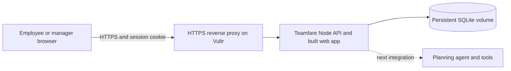

# Backend foundation

## Components

- **Web:** existing React/TypeScript/Vite app. Root restores the cookie session or shows account registration/sign-in. An explicit sample-team option preserves the separate local preview.
- **API:** Fastify on Node 24 LTS, with request validation, cookies, rate limiting and production static serving.
- **Storage:** Node's built-in SQLite API. Schema version 1 creates tables for teams, users, sessions, invitations, plans, expenses and saved ideas. WAL mode and a five-second busy timeout support a single VM process with concurrent requests. No hosted database service or service-role browser key is needed.
- **Permissions:** every protected endpoint resolves the server session and team. The client cannot assign an existing team's role or supply authoritative approval, audit history, plan identity or unit price.

This is a single-instance foundation. It has not been load-tested for a larger organisation or deployed on Vultr. Keep persistent storage on the VM or mounted Docker volume; an ephemeral container filesystem is not sufficient.

## Identity and sessions

Creating a team creates its first manager. Joining an existing team requires a server-issued invitation; the invitation carries the permitted role. Only a manager can create employee or manager invitations. Each code is a random 32-byte value, expires after three days and is consumed atomically once. Only its SHA-256 digest is stored; share the displayed code directly with its intended recipient.

Passwords require 12–128 characters and use salted scrypt (`N=32768`, `r=8`, `p=1`, 64-byte output). A dummy hash calculation is used for unknown-user login attempts. No passwords or request bodies are logged.

Sessions use random 32-byte cookies, with only their SHA-256 digest in the database. Sessions expire after seven days. Cookies are HttpOnly, SameSite=Lax and host-only; production also sets Secure. Signing in replaces the presented session, and signing out revokes it server-side. CSRF tokens stay in client memory and are required alongside the configured Origin on authenticated mutations. API responses use `Cache-Control: no-store`.

New-account and sign-in routes share an IP rate limit of ten attempts per ten minutes. General requests are limited to 180 per minute. The app does not trust forwarded client addresses by default. `TRUST_PROXY=1` trusts exactly one proxy hop and must only be used behind a controlled proxy with the API port private.

Email addresses are not verified yet; email delivery, password recovery and account administration are later work. Never describe these accounts as email-verified. There are no preset shared passwords or production judge accounts.

## Workflow rules

| Action | Enforced permission/state |
| --- | --- |
| Create plan | Signed-in team member; server assigns ID, creator, Draft and catalogue unit-price snapshot |
| Edit/save/submit | Plan creator only; Draft or Changes requested; attendees belong to team and include creator |
| Send for review | Valid details and estimate within budget |
| Approve/request changes | Different manager in the same team; Awaiting approval; changes require a note |
| Approve | Also rejects a past date or over-budget estimate |
| RSVP | Named attendee; approved, unsettled outing on today or a later date |
| Record expense | Approved and unsettled; employee is organiser/attendee and payer is self, or manager chooses a teammate |
| Cancel | Creator or team manager; retains expenses and history |
| Settle | Manager; past approved outing; closes expense recording |
| Save idea/preferences | Current account only |

Prices come from the sample catalogue and are captured on the plan. Saving draft details refreshes that snapshot; approved totals are not recomputed from a later catalogue price. Amounts are positive integer naira for expenses; group budgets are nonnegative integer naira. Expense dates cannot be in the future. Server-generated events record actual actors and actions.

Plans have monotonically increasing revisions. Edit, review, RSVP and settlement requests must provide the displayed revision. Stale writes return 409 and the client refreshes the latest state. Expense insertion and its activity update are one database transaction. The UI waits for server success before announcing a completed action, and reports connection failures instead of saving locally as a substitute.

## API surface

| Route | Purpose |
| --- | --- |
| `GET /api/health` | Readiness response |
| `GET /api/session` | Restore identity, CSRF token and initial state, or report no session |
| `POST /api/auth/register` | Create account and new team |
| `POST /api/auth/login` / `logout` | Start or revoke session |
| `POST /api/auth/join` | Consume invitation and create teammate account |
| `POST /api/invites` | Manager generates a one-use code |
| `GET /api/state` | Current team plans, expenses and members; personal saved ideas/preferences |
| `POST /api/plans` | Create draft |
| `PUT /api/plans/:id` | Save draft or submit for review |
| `POST /api/plans/:id/action` | Approve, request-changes, cancel or settle |
| `POST /api/plans/:id/rsvp` | Respond to outing |
| `POST /api/expenses` | Record expense |
| `PUT /api/preferences` | Save own dietary preference |
| `PUT /api/saved/:id` | Save/unsave an idea |

## Local configuration

| Setting | Default |
| --- | --- |
| `HOST` | `127.0.0.1` |
| `PORT` | `3001` |
| `APP_ORIGIN` | `http://localhost:5173` |
| `DATABASE_PATH` | `./data/teamfare.sqlite` |
| `TZ` | Set `Africa/Lagos` in `.env`; container already uses it |
| `TRUST_PROXY` | Off; `1` for exactly one trusted proxy |

Vite reads `.env` for its local port and API proxy. It fails on an occupied port rather than silently moving to an origin the API will reject. Only `VITE_` values are available to application code; none are needed here. Server workflow date validation explicitly uses Africa/Lagos. Future international deployment will need per-team timezone support.

## Vultr VM deployment preparation

The repository supplies a multi-stage Dockerfile, `compose.yaml`, and an example host Caddy configuration under `deploy/`. This configuration has not been run against a Vultr account. Docker could not be built locally because Docker Desktop's Linux engine was not running; native production static/API serving was tested instead.

On a prepared Vultr VM, the intended deployment is:

1. Use Node 24 LTS directly, or build the provided container with Docker Compose.
2. Set `APP_ORIGIN` to the exact public HTTPS URL. Production refuses an HTTP origin and uses Secure session cookies.
3. Point the domain to the VM and configure the controlled HTTPS proxy. `deploy/Caddyfile` expects `TEAMFARE_DOMAIN` in the Caddy service environment and forwards to `127.0.0.1:3001`.
4. For Compose, `docker compose up -d --build` builds the web bundle and serves it alongside `/api`. The API port binds to host loopback; the named volume `teamfare-data` retains the database.
5. Keep the SQLite directory and volume private. Do not expose the API port separately when trusting forwarded addresses. Production headers include CSP, HSTS, frame denial, and MIME sniffing protection.
6. Back up the database with a SQLite-consistent backup mechanism. For an offline copy, stop the process before copying the database directory and WAL files. Test restoring a backup before relying on it.

Without Docker, run `npm ci`, `npm run build`, then run `npm start` with `NODE_ENV=production`, `APP_ORIGIN`, a persistent `DATABASE_PATH` and the required bind/proxy settings in the service environment.

Deployment, DNS, email delivery and AI/model credentials are not configured by this change. No external infrastructure, messages or bookings were created.

## Sources checked

- [Node SQLite documentation](https://nodejs.org/api/sqlite.html)
- [Fastify server documentation](https://fastify.dev/docs/latest/Reference/Server/)
- [Fastify cookie plugin](https://github.com/fastify/fastify-cookie)
- [Fastify rate-limit plugin](https://github.com/fastify/fastify-rate-limit)
