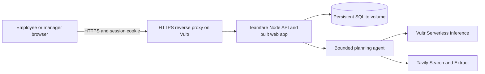

# Backend foundation

## Components

- **Web:** existing React/TypeScript/Vite app. Root restores the cookie session or shows account registration/sign-in. An explicit sample-team option preserves the separate local preview.
- **API:** Fastify on Node 24 LTS, with request validation, cookies, rate limiting and production static serving.
- **Storage:** Node's built-in SQLite API. Schema version 1 creates tables for teams, users, sessions, invitations, plans, expenses and saved ideas; version 2 adds research runs; versions 3 and 4 add email verification, account challenges, notification outbox, audit events, persisted limits and session inactivity tracking. WAL mode and a five-second busy timeout support a single VM process with concurrent requests. No hosted database service or service-role browser key is needed.
- **Permissions:** every protected endpoint resolves the server session and team. The client cannot assign an existing team's role or supply authoritative approval, audit history, plan identity or unit price.

Schema version 5 adds explicit operator-seeded judge markers. It preserves existing accounts and sessions; normal signup cannot grant public judge status. Expense reporting supports inclusive date ranges and exports the same filtered rows shown in the ledger.

Schema version 6 adds email preferences/interests, the encrypted workflow outbox, versioned availability replies, private receipt bytes and idempotent expense requests. Existing accounts, credentials and sessions survive. See [coordination and expense rules/API](WORKFLOWS.md).

This is a single-instance deployment on Vultr. It has not been load-tested for a larger organisation. SQLite persists in a private mounted Docker volume; an ephemeral container filesystem is not sufficient.

## Identity and sessions

Creating a team creates its first manager only after email ownership verification. Joining an existing team requires a server-issued invitation; the invitation carries the permitted role. Only a manager can create employee or manager invitations. Each code is a random 32-byte value, expires after three days and is consumed atomically once. The invitation table stores its SHA-256 digest; share the displayed code directly or email it to a specific recipient. Emailing binds the invite to that address and stores its delivery payload encrypted in the workflow outbox.

New passwords require 15–128 characters and use salted scrypt (`N=32768`, `r=8`, `p=1`, 64-byte output). A dummy hash calculation is used for unknown-user login attempts. No passwords or request bodies are logged.

Sessions use random 32-byte cookies, with only their SHA-256 digest in the database. Sessions expire after seven days or thirty minutes without an authenticated request. Cookies are HttpOnly, SameSite=Lax and host-only; production also sets Secure. Signing in replaces the presented session, and signing out revokes it server-side. CSRF tokens stay in client memory and are required alongside the configured Origin on authenticated mutations. API responses use `Cache-Control: no-store`.

New-account and sign-in routes share an IP rate limit of ten attempts per ten minutes. General requests are limited to 180 per minute per valid signed-in user, falling back to IP for unauthenticated requests. Shared-office users do not share the general allowance. Authentication and code endpoints retain IP-based limits independently. The app does not trust forwarded client addresses by default. `TRUST_PROXY=1` trusts exactly one proxy hop and must only be used behind a controlled proxy with the API port private.

Email verification is mandatory before real-account activation and fresh sign-in. Password recovery and changes revoke sessions and pending proofs; security notifications are durably queued. The upgrade revokes previous sessions and requires legacy users to verify email. See [authentication rules and delivery setup](AUTHENTICATION.md). Account administration and email-address changes remain later work. Two explicitly seeded public judge accounts form a separate shared team; only these identities skip OTP, and cannot change credentials, invite members or revoke other visitors' sessions. See [judge access](JUDGING.md).

## Workflow rules

| Action                  | Enforced permission/state                                                                               |
| ----------------------- | ------------------------------------------------------------------------------------------------------- |
| Create plan             | Signed-in team member; server assigns ID, creator, Draft and catalogue unit-price snapshot              |
| Edit/save/submit        | Plan creator only; Draft or Changes requested; attendees belong to team and include creator             |
| Send for review         | Valid details and estimate within budget                                                                |
| Approve/request changes | Different manager in the same team; Awaiting approval; changes require a note                           |
| Approve                 | Also rejects a past date or over-budget estimate                                                        |
| RSVP                    | Named attendee; approved, unsettled outing on today or a later date                                     |
| Record expense          | Approved and unsettled; employee is organiser/attendee and payer is self, or manager chooses a teammate |
| Cancel                  | Creator or team manager; retains expenses and history                                                   |
| Settle                  | Manager; past approved outing; closes expense recording                                                 |
| Save idea/preferences   | Current account only                                                                                    |

Manual plan prices come from the sample catalogue and are captured on the plan. Saving manual draft details refreshes that snapshot; approved totals are not recomputed from a later catalogue price. Researched plans retain their cost lines and evidence. Their totals sum per-person lines multiplied by headcount plus fixed lines; rounded average-per-person values are display-only. Editing a sourced figure removes its published-price claim and marks it as an estimate. Amounts are integer naira for cost lines and expenses; group budgets are nonnegative integer naira. Expense dates cannot be in the future. Server-generated events record actual actors and actions.

Plans have monotonically increasing revisions. Edit, review, RSVP and settlement requests must provide the displayed revision. Stale writes return 409 and the client refreshes the latest state. Expense insertion and its activity update are one database transaction. The UI waits for server success before announcing a completed action, and reports connection failures instead of saving locally as a substitute.

## API surface

| Route                             | Purpose                                                                    |
| --------------------------------- | -------------------------------------------------------------------------- |
| `GET /api/health`                 | Readiness response                                                         |
| `GET /api/session`                | Restore identity, CSRF token and initial state, or report no session       |
| `POST /api/auth/register`         | Start pending signup and email proof                                       |
| `POST /api/auth/login` / `logout` | Start login email proof or revoke a session                                |
| `POST /api/auth/join`             | Validate invitation and start signup email proof                           |
| `POST /api/invites`               | Manager generates a one-use code                                           |
| `GET /api/state`                  | Current team plans, expenses and members; personal saved ideas/preferences |
| `POST /api/plans`                 | Create draft                                                               |
| `PUT /api/plans/:id`              | Save draft or submit for review                                            |
| `POST /api/plans/:id/action`      | Approve, request-changes, cancel or settle                                 |
| `POST /api/plans/:id/rsvp`        | Respond to outing                                                          |
| `POST /api/expenses`              | Record expense                                                             |
| `PUT /api/preferences`            | Save own dietary preference                                                |
| `PUT /api/saved/:id`              | Save/unsave an idea                                                        |
| `GET /api/research/config`        | Authenticated provider readiness; missing setting names, never secrets     |
| `POST /api/research`              | Start idempotent, bounded research for the current user                    |
| `GET /api/research/:id`           | Owner reads a run; same-team members may also read an accepted run         |
| `POST /api/research/:id/cancel`   | Owner cancels unfinished research                                          |
| `POST /api/research/:id/accept`   | Owner saves one result as a draft, transactionally and idempotently        |

See also `GET /api/auth/config`, `POST /api/auth/verify`, `/resend`, `/forgot-password`, `/reset-password`, `/change-password` and `/logout-all`. Proof verification creates the session; password validation alone does not. Recovery responses do not reveal whether an account exists.

## Local configuration

| Setting                   | Default                                                 |
| ------------------------- | ------------------------------------------------------- |
| `HOST`                    | `127.0.0.1`                                             |
| `PORT`                    | `3001`                                                  |
| `APP_ORIGIN`              | `http://localhost:5173`                                 |
| `DATABASE_PATH`           | `./data/teamfare.sqlite`                                |
| `TZ`                      | Set `Africa/Lagos` in `.env`; container already uses it |
| `TRUST_PROXY`             | Off; `1` for exactly one trusted proxy                  |
| `VULTR_INFERENCE_API_KEY` | Unset; inference key, server only                       |
| `VULTR_INFERENCE_MODEL`   | Unset; select a current tool-calling text model         |
| `TAVILY_API_KEY`          | Unset; search/extraction key, server only               |

Vite reads `.env` for its local port and API proxy. It fails on an occupied port rather than silently moving to an origin the API will reject. Only `VITE_` values are available to application code; none are needed here. Server workflow date validation explicitly uses Africa/Lagos. Future international deployment will need per-team timezone support.

Account settings also require `RESEND_API_KEY`, `EMAIL_FROM` on a verified sender domain, and a random `AUTH_SECRET` of at least 32 characters. Keep them server-only and stable across restarts. See [authentication setup](AUTHENTICATION.md).

## Vultr VM deployment

The live deployment at [teamfare.dixmail.xyz](https://teamfare.dixmail.xyz) uses the multi-stage Dockerfile, `compose.yaml` and `deploy/compose.production.yaml`. Caddy terminates public HTTPS; the nonroot app container has a read-only filesystem and private persistent SQLite volume. Public TLS, security headers, file permissions, protected initial account migration and the daily backup timer were verified. See the [deployment runbook](DEPLOYMENT.md) for operational details and workflow verification.

On a prepared Vultr VM, the intended deployment is:

1. Use Node 24 LTS directly, or build the provided container with Docker Compose.
2. Set `APP_ORIGIN` to the exact public HTTPS URL. Production refuses an HTTP origin and uses Secure session cookies.
3. Point the domain to the VM and configure the controlled HTTPS proxy. `deploy/Caddyfile` expects `TEAMFARE_DOMAIN` in the Caddy service environment and forwards to `127.0.0.1:3001`.
4. For Compose, `docker compose up -d --build` builds the web bundle and serves it alongside `/api`. The API port binds to host loopback; the named volume `teamfare-data` retains the database.
5. Keep the SQLite directory and volume private. Do not expose the API port separately when trusting forwarded addresses. Production headers include CSP, HSTS, frame denial, and MIME sniffing protection.
6. Back up the database with a SQLite-consistent backup mechanism. For an offline copy, stop the process before copying the database directory and WAL files. Test restoring a backup before relying on it.

Without Docker, run `npm ci`, `npm run build`, then run `npm start` with `NODE_ENV=production`, `APP_ORIGIN`, a persistent `DATABASE_PATH` and the required bind/proxy settings in the service environment.

A real local research-to-approval browser check passed on 4 November 2026; deployment verification is recorded separately in the runbook. Authentication email delivery uses Resend and the verified sender domain. Real authentication test emails were delivered and confirmed. The subsequent workflow release also verified real outing/review/cancellation/report mail; venue booking remains external. See [provider setup and credit redemption](PROVIDER-SETUP.md) and [agent boundaries and verification](AGENT-REVIEW.md). The agent runs in the central API with fixed provider endpoints, bounded tool calls, three-minute execution limits and persisted per-user quotas. It never executes model-generated code or contacts venue URLs directly.

## Sources checked

- [Node SQLite documentation](https://nodejs.org/api/sqlite.html)
- [Fastify server documentation](https://fastify.dev/docs/latest/Reference/Server/)
- [Fastify cookie plugin](https://github.com/fastify/fastify-cookie)
- [Fastify rate-limit plugin](https://github.com/fastify/fastify-rate-limit)
